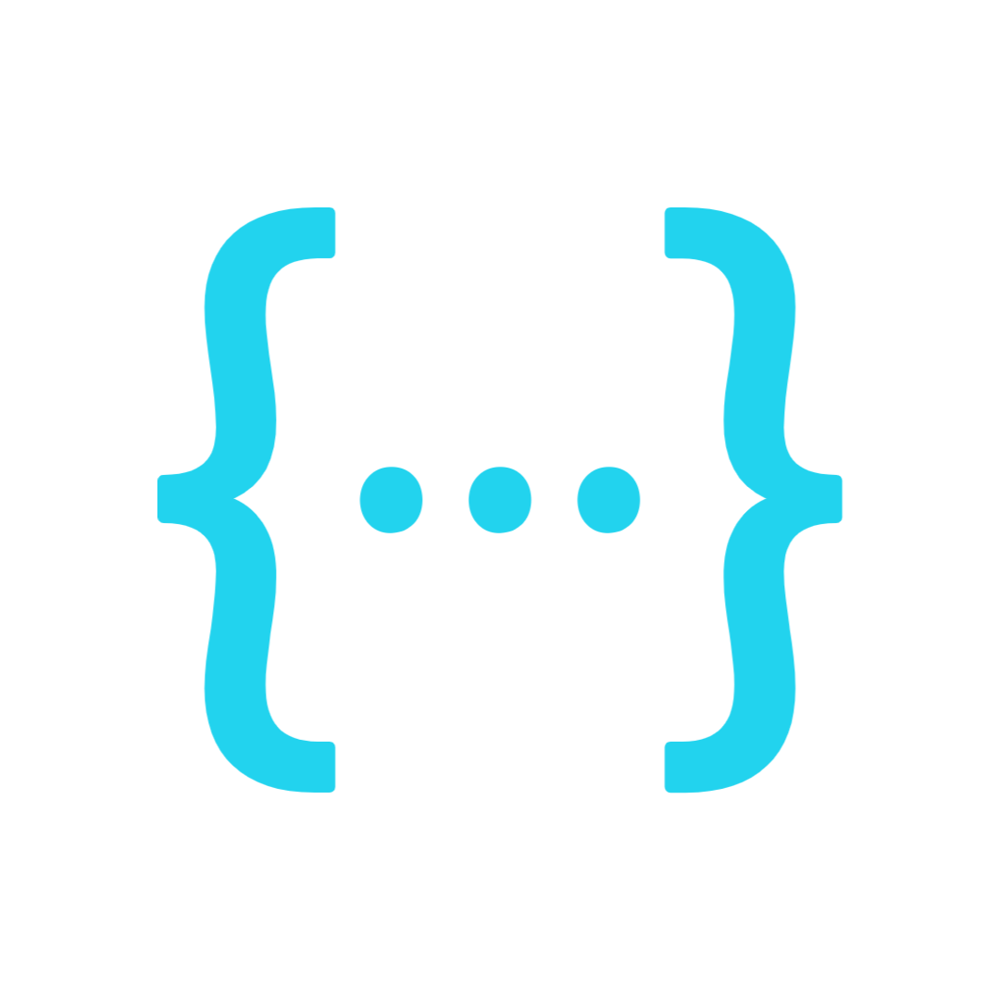

<a href="https://www.zeljkovic.com">

</a>

 &nbsp;
 &nbsp;

 

## Hi, I'm Aleksandar 👋

I help software teams build test automation they can trust: fast, stable suites that run in CI and catch problems before customers do.

10+ years in quality engineering as a hands-on SDET, Lead QA and Head of QA, most recently building shared test tooling and CI/CD pipelines for engineering teams at a large SaaS company.

**Available for consulting engagements and senior/staff roles.** Based in Novi Sad, Serbia (CET), working remotely with teams in Europe and the US.

### What I help with

- 🐢 **Slow or flaky E2E suites:** stabilising tests and getting CI feedback back under control
- 🏗️ **Test framework design:** Playwright + TypeScript setups covering UI and API layers
- 🔁 **CI/CD test pipelines:** parallelisation, test data, reporting and quality gates
- 🔀 **Migrations:** moving from Cypress or Selenium to Playwright
- 🧭 **Test strategy and QA leadership:** for teams where nobody clearly owns quality

### Start here

| Project | What it shows |
|---|---|
| [⚡ lighty](https://github.com/azeljkovic/lighty) | A typed HTTP testing library for Node.js, published on npm, with unit and integration tests, CI checks, automated publishing and a docs site |
| [lighty-examples](https://github.com/azeljkovic/lighty-examples) | Practical API test examples using lighty against httpbin: requests, assertions, redirects, auth, error handling |
| [cypress-vs-playwright](https://github.com/azeljkovic/cypress-vs-playwright) | The same test scenarios written in Cypress and Playwright, both running in GitHub Actions; companion code for my talk *Clash of the Titans: Cypress vs Playwright* |

### Tools I work with

**Testing:** Playwright · Cypress · Selenium · k6 · Jest · node:test
**Languages:** TypeScript · JavaScript · Node.js · Python · SQL
**CI/CD & infrastructure:** GitHub Actions · Spinnaker · Jenkins · Docker · Kubernetes · AWS · GCP

### Talks & writing

- 🎤 **Clash of the Titans: Cypress vs Playwright** · Continuous Testing Meetup
- 🎤 **The elements of test automation** · Regional Scrum Gathering 2021
- 🎤 **Automation beyond the Selenium script** · Romanian Testing Conference 2020
- 🎤 **(Testing) Expectations VS (Augmented) Reality** · Agile Testing Days 2019 and SEETEST 2019
- 📝 **Static Code Analysis: The Underrated Ally** · Quality Matters magazine, issue 12 (2021)
- 📝 **Summoning your API test automation in one day** · Quality Matters magazine, issue 10 (2020)
- ✍️ More articles and notes at [zeljkovic.com](https://www.zeljkovic.com)

**Certifications:** ISTQB® Advanced Level Test Manager · ISTQB® Foundation Level · ISTQB® Agile Tester Extension

### Work with me

Have a test suite nobody trusts, or a pipeline that takes too long? Email [aleksandar@zeljkovic.com](mailto:aleksandar@zeljkovic.com) or message me on [LinkedIn](https://www.linkedin.com/in/a-zeljkovic).
